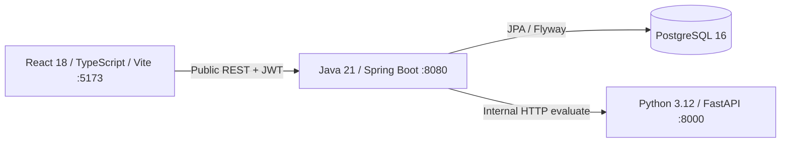

# Architecture

ALFA Business Navigator is a synthetic demonstration. It has no connection to banking systems, tax authorities, credit bureaus, or real transfers.

Only frontend and backend ports bind to localhost. PostgreSQL and Python remain inside the Compose network. The browser calls `/api/v1`; Vite proxies to backend. React never calls the engine. All scoring and forecast mathematics live in Python. A recommendation never changes the application to OFFERED: the bank officer makes every final decision.

Backend uses strict record DTOs and Bean Validation. Unknown input fields, fractional rubles, negative inputs, invalid product limits and nonconsecutive financial months fail validation. A signed one-hour JWT contains only user identity; roles and company membership reload from the database on each request. BCrypt protects stored synthetic passwords. Company and application ownership checks run on the server.

Submission uses two database transactions around the external engine call. The first locks the application and company, commits CHECKING plus an immutable snapshot, and releases locks before HTTP. The second locks the application and persists score and UNDER_REVIEW only for the matching snapshot. A unique score-per-snapshot constraint and row locks protect concurrent retries. Failed HTTP calls leave CHECKING and return 503; retry reuses the same snapshot and does not duplicate history or scores. Resubmission after NEEDS_INFO captures a new snapshot. Read views expose the score corresponding to the current snapshot only.

`@Version` and pessimistic row locks prevent double decisions or lost financial updates. Company replacement is atomic. Snapshot JSON includes company financial version, product, and exact internal request; complete engine responses persist for audit. UTC timestamps use microsecond precision to match PostgreSQL.

The default credentials and signing key are intentionally public demo values. This application is not hardened for public deployment: no MFA, refresh tokens, password reset, production secrets management or real underwriting are included.
