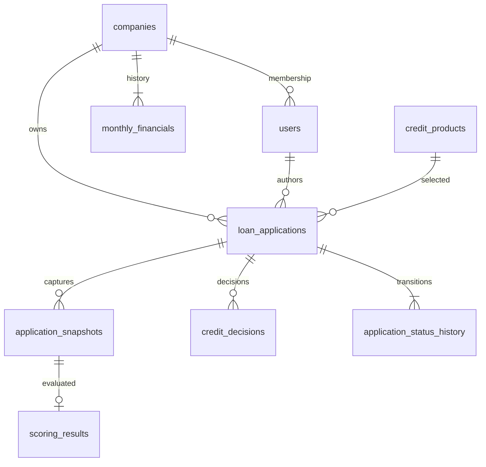

# Data model

All IDs are positive BIGINT identity values. Money uses BIGINT rubles, rates and DSCR use decimals. Timestamps are UTC. Flyway creates the schema and fixed seed once; JPA validates it at startup. No automatic destructive schema generation is enabled.

| Table | Purpose and constraints |
|---|---|
| companies | Unique synthetic INN, nonnegative finances, financials_version and concurrency version |
| users | Unique email, BCrypt password_hash, role and nullable company_id |
| monthly_financials | Unique company_id/month, nonnegative values; replacement API enforces 12 consecutive months |
| credit_products | Fixed rates, limits and comma-separated allowed terms exposed as integer arrays |
| loan_applications | Company and author foreign keys, product/parameters, guarded status, active_snapshot_id, version |
| application_snapshots | Append-only company_and_financials_snapshot_json, product_snapshot_json, engine_request_json and captured_at |
| scoring_results | One result per snapshot_id, all score fields, factors_json and full_result_json |
| credit_decisions | Append-only decision/comment/offered parameters and deciding user/time |
| application_status_history | Append-only from/to status, actorRole/comment/time, including initial null -> DRAFT |

Indexes support application company, status and creation time and child history/snapshot/decision access. Historical snapshots and scores are never overwritten by financial edits. ApplicationView exposes the current snapshot; prior versions remain auditable in SQL. PostgreSQL uses the `postgres-data` named volume: `docker compose down` preserves data, while `down -v` deliberately removes it and must not be used for restart verification.

Seed: company1 `7700000001`, company2 `7700000002`, 12 fixed months October 2025 to September 2026. Revenue cycle [1900000,2000000,2100000,2200000], expense cycle [1300000,1400000,1450000,1500000], each repeated three times. Company2 and owner2 are additional synthetic isolation-test fixtures. Both product IDs and company IDs match documented fixtures.
