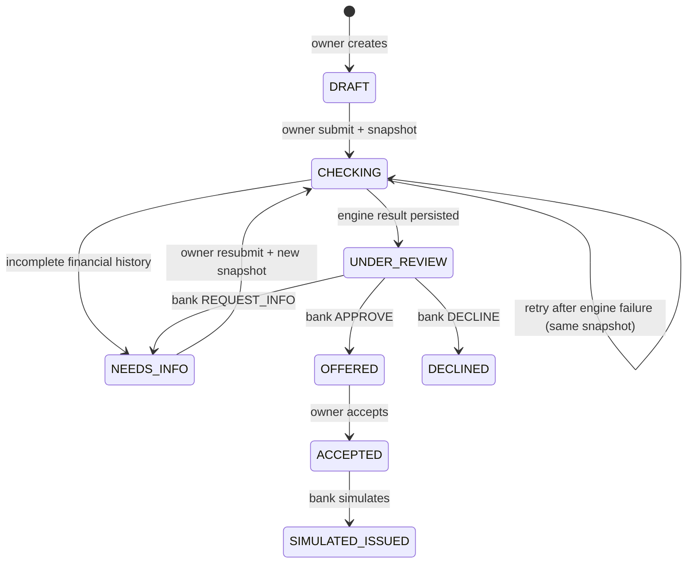

# Application status state machine

Owner can edit application parameters in DRAFT or NEEDS_INFO. Editing NEEDS_INFO preserves that status. Only the author within the owning company can submit, edit or accept. Bank officers can read all applications and act only on the bank routes. Every transition writes a history entry. Invalid transitions return 409; missing role or ownership returns 403. Repeating submit on an already completed check returns 409; concurrent CHECKING retries can evaluate twice but persist only one result and one completion transition.

An APPROVE decision requires a product-valid amount no greater than requested, valid term and comment. Rate always comes from the server product. DECLINE/REQUEST_INFO require a nonblank comment and reject offer-only fields. No transfer takes place at SIMULATED_ISSUED. Engine timeout, network failure, invalid response or error returns ENGINE_UNAVAILABLE / 503 and leaves CHECKING. A new review always requires bank action even if the engine recommends APPROVE or DECLINE.
