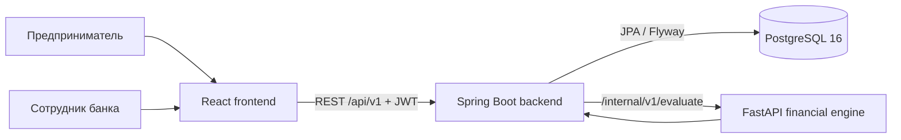
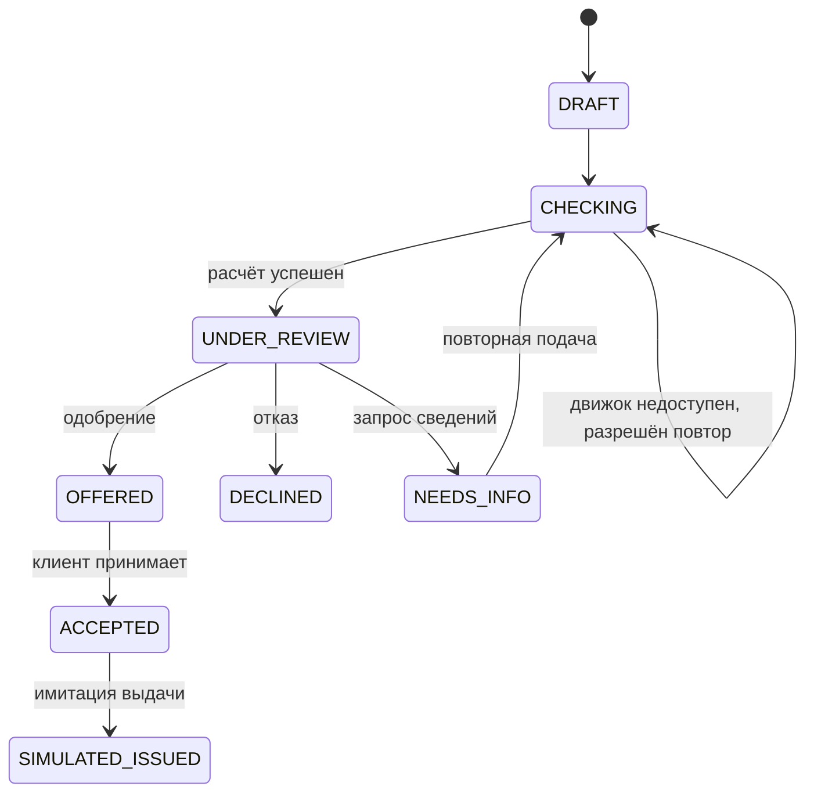

# Техническое описание

## Архитектура



Frontend никогда не обращается к финансовому движку напрямую. Backend отвечает за аутентификацию, владение компанией, статусные переходы, снимки данных и сохранение результата.

## Расчёты

Аннуитетный платёж рассчитывается с использованием `Decimal` и округлением до целых рублей. При нулевой ставке сумма делится на срок.

```text
monthly_rate = annual_rate_pct / 1200
payment = principal × monthly_rate / (1 − (1 + monthly_rate)^−term)
```

DSCR использует операционную маржу последних трёх месяцев и текущие долговые платежи:

```text
DSCR = max(0, revenue − operating_expenses)
       / max(1, existing_debt_payment + new_payment)
```

Пользовательская гипотеза роста выручки участвует в прогнозе денежных средств, но не повышает исходный DSCR.

## Сценарии

- `BASE` — средняя выручка последних трёх месяцев и пользовательская гипотеза роста.
- `STRESS_15` — базовая выручка снижена на 15%.
- `STRESS_30` — базовая выручка снижена на 30%.

Для каждого сценария строятся 12 месячных точек: выручка, расходы, долговые платежи, чистый поток и остаток денежных средств.

## Объяснимый скоринг

Начальное значение — 1000 баллов. Правила могут снижать результат за:

- недостаточный DSCR;
- отрицательные месяцы;
- просрочки;
- небольшой срок работы компании;
- синтетическую налоговую задолженность;
- недостаточный денежный резерв.

Каждый фактор сохраняется с кодом, сообщением и количеством баллов. Неактивная компания получает рекомендацию отказа независимо от балла. Итоговый score ограничен диапазоном 0–1000.

Это детерминированная эвристика, а не модель вероятности дефолта и не банковское решение.

## Статусный процесс



## Надёжность

- Строгая проверка входных DTO и неизвестных полей.
- JWT и разделение ролей предпринимателя и сотрудника банка.
- Проверка владения компанией для каждого действия предпринимателя.
- Неизменяемые снимки финансовых данных при подаче.
- Транзакционная фиксация статусов, решений и истории.
- Оптимистическая защита от конфликтующих действий.
- При недоступности движка возвращается `503 ENGINE_UNAVAILABLE`; фиктивный score не создаётся.
- PostgreSQL и финансовый движок не публикуются наружу в стандартном Compose.

## Проверка

Полный сценарий запускается командой:

```bash
./scripts/verify-compose.sh
```

Он проверяет OpenAPI, роли, изоляцию компаний, три варианта решения, снимки, перезапуск сервисов, недоступность и восстановление движка, а также конкурентные запросы.

